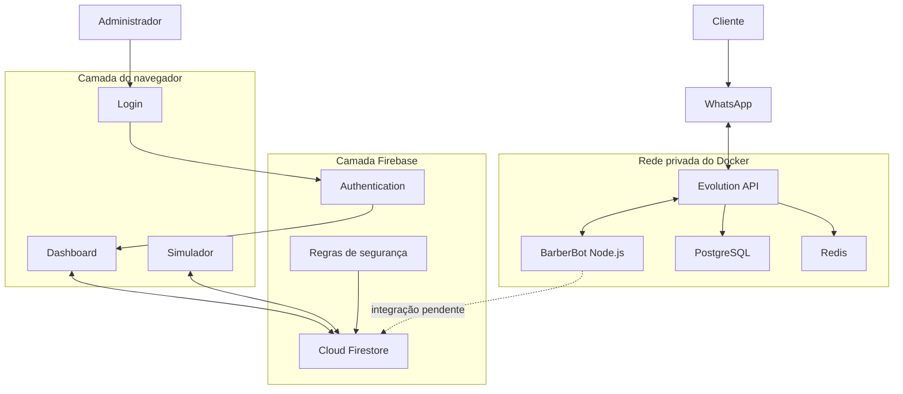

# Raio X do BarberBot

## Como reconstruir o projeto manualmente, de cima para baixo

Este documento explica a criação do BarberBot como se o projeto ainda não existisse. A proposta não é apenas mostrar comandos: é explicar a hierarquia, a ordem das decisões, as dependências e o motivo de cada camada.

Ao terminar a leitura, você deverá conseguir responder:

- qual problema o sistema resolve;
- quais são as partes do projeto;
- o que precisa ser construído primeiro;
- como o navegador, o Firebase, o Docker e o WhatsApp se comunicam;
- qual arquivo é responsável por cada função;
- quais partes já estão completas;
- quais partes ainda precisam ser finalizadas;
- como reconstruir tudo manualmente em uma sequência segura.

---

## 1. A visão mais alta do sistema

O projeto possui dois caminhos principais.

### Caminho administrativo

```text
Administrador
    ↓
Tela de login
    ↓
Painel administrativo
    ↓
Firebase Authentication + Firestore
```

Esse lado permite administrar clientes, barbeiros, serviços, horários e agendamentos.

### Caminho do cliente

```text
Cliente
    ↓
WhatsApp ou simulador
    ↓
BarberBot
    ↓
Agendamento
    ↓
Painel administrativo
```

O simulador já completa esse caminho até o Firestore. A integração pelo WhatsApp já conversa com o cliente, mas ainda precisa gravar a confirmação no Firestore.

### Arquitetura completa



---

## 2. Hierarquia das camadas

Uma forma simples de entender o projeto é imaginar um prédio.

### Nível 1 — experiência do usuário

É o que aparece na tela:

- login;
- menu lateral;
- indicadores;
- tabelas;
- formulários;
- modais;
- notificações;
- conversa do simulador.

Arquivos principais:

```text
index.html
style.css
simulador.html
simulador.css
```

### Nível 2 — comportamento da aplicação

É o JavaScript que responde aos cliques e transforma dados em interface:

- abre e fecha modais;
- valida formulários;
- calcula horários;
- renderiza listas;
- atualiza indicadores;
- controla o fluxo da conversa.

Arquivos principais:

```text
script.js
simulador.js
```

### Nível 3 — dados e autenticação

É onde ficam os usuários e os dados permanentes:

- Firebase Authentication;
- Cloud Firestore;
- regras de segurança;
- listeners em tempo real.

Arquivo de ligação:

```text
firebase.js
```

### Nível 4 — integração com o WhatsApp

É o servidor que não pode rodar no navegador:

- recebe mensagens;
- controla etapas da conversa;
- envia respostas;
- mantém sessões;
- registra confirmações locais.

Arquivos principais:

```text
bot/server.js
bot/Dockerfile
evolution/docker-compose.yml
```

### Nível 5 — infraestrutura

É o que mantém os serviços em execução:

- WSL 2;
- Docker Desktop;
- contêineres;
- PostgreSQL;
- Redis;
- volumes persistentes;
- rede privada.

---

## 3. Ordem correta de construção

Se o projeto fosse criado manualmente, a ordem recomendada seria:

```text
1. Definir requisitos
2. Modelar os dados
3. Criar a estrutura HTML
4. Criar o CSS
5. Criar o Firebase
6. Implementar login e segurança
7. Implementar leitura e gravação no Firestore
8. Implementar funcionalidades do painel
9. Criar o simulador
10. Testar o fluxo sem WhatsApp
11. Instalar Docker e WSL
12. Instalar Evolution API
13. Criar o bot Node.js
14. Configurar webhook
15. Conectar o WhatsApp
16. Integrar o bot ao Firestore
17. Testar segurança e falhas
18. Preparar implantação
```

Não é recomendado começar pelo WhatsApp. Primeiro deve existir um sistema de agendamento confiável e testado; o WhatsApp será apenas uma nova porta de entrada.

---

## 4. Etapa zero — requisitos do negócio

Antes de programar, escreva o que a barbearia precisa.

### Entidades principais

- administrador;
- cliente;
- barbeiro;
- serviço;
- agendamento;
- horário de funcionamento;
- configuração da barbearia;
- notificação.

### Regras principais

- somente o administrador entra no painel;
- apenas barbeiros ativos aparecem para agendamento;
- apenas serviços ativos aparecem para agendamento;
- um horário não pode se sobrepor a outro;
- um agendamento deve possuir cliente, serviço, barbeiro, data e horário;
- cancelamentos não ocupam horário;
- o painel não deve mostrar clientes fictícios;
- notificações só aparecem quando houver informação real;
- o bot não deve confirmar antes de revalidar a disponibilidade.

### Estados de um agendamento

```text
scheduled   → Agendado
confirmed   → Confirmado
in-service  → Em atendimento
cancelled   → Cancelado
```

Essa definição deve acontecer antes do HTML e do banco, porque todos os componentes dependerão dela.

---

## 5. Modelagem dos dados

Antes da interface, desenhe como os dados serão armazenados.

### Coleção `agendamentos`

```js
{
  client: "Nome do cliente",
  phone: "Telefone normalizado",
  service: "Corte",
  barber: "Nome do barbeiro",
  date: "2026-11-12",
  time: "14:00",
  duration: 30,
  price: 40,
  status: "scheduled",
  source: "dashboard",
  createdAt: "timestamp"
}
```

### Coleção `clientes`

```js
{
  name: "Nome",
  phone: "Telefone",
  email: "E-mail opcional",
  createdAt: "timestamp"
}
```

### Coleção `barbeiros`

```js
{
  name: "Nome",
  phone: "Telefone opcional",
  status: "ativo",
  createdAt: "timestamp"
}
```

### Coleção `servicos`

```js
{
  name: "Corte",
  duration: 30,
  price: 40,
  status: "ativo",
  createdAt: "timestamp"
}
```

### Documento `configuracoes/horarios`

```js
{
  days: [1, 2, 3, 4, 5, 6],
  opening: "09:00",
  closing: "19:00",
  interval: 30
}
```

### Documento `configuracoes/barbearia`

```js
{
  name: "Barbearia Fio de Ouro",
  phone: "Telefone comercial",
  address: "Endereço",
  city: "Cidade",
  minimumNotice: 2,
  welcomeMessage: "Mensagem inicial"
}
```

### Decisões importantes

- datas são armazenadas como `AAAA-MM-DD` para facilitar filtros;
- horários são armazenados como `HH:MM`;
- duração é número em minutos;
- preço é número, não texto formatado;
- status usa valores fixos;
- `source` informa se veio do painel, simulador ou WhatsApp.

---

## 6. Criando a estrutura de pastas

Comece com uma estrutura pequena:

```text
barbearia-agente/
├── index.html
├── style.css
├── script.js
├── firebase.js
├── midias/
└── README.md
```

Depois acrescente novas camadas:

```text
├── simulador.html
├── simulador.css
├── simulador.js
├── bot/
├── evolution/
└── functions/
```

Regra de organização:

- arquivos do navegador ficam na raiz;
- servidor do bot fica em `bot`;
- infraestrutura Docker fica em `evolution`;
- integração oficial futura fica em `functions`;
- imagens ficam em `midias`.

---

## 7. Construindo o HTML do painel

O HTML deve ser feito antes do JavaScript, pois o JavaScript precisa encontrar elementos existentes.

### Ordem recomendada do `index.html`

```text
1. <!DOCTYPE html>
2. <head>
3. Tela de login
4. Contêiner principal do painel
5. Menu lateral
6. Barra superior
7. Área de boas-vindas
8. Indicadores
9. Tabela de agendamentos
10. Ações rápidas
11. Área de notificações
12. Modais
13. Importação do script como módulo
```

### Por que os IDs são importantes

O JavaScript encontra elementos por seletores:

```js
document.querySelector("#form-agendamento");
document.querySelector("#lista-agendamentos");
document.querySelector("#abrir-configuracoes");
```

Se um ID for alterado no HTML, o JavaScript também precisa ser alterado.

### Modais

Os modais são páginas flutuantes sobre o painel.

Estrutura básica:

```html
<div class="modal-overlay" hidden>
  <div class="modal-conteudo" role="dialog" aria-modal="true">
    <button type="button" class="fechar-modal">×</button>
    <h2>Título</h2>
    <form>...</form>
  </div>
</div>
```

O efeito de flutuação vem principalmente do CSS:

```css
.modal-overlay {
  position: fixed;
  inset: 0;
  display: grid;
  place-items: center;
  background: rgba(0, 0, 0, 0.65);
  z-index: 1000;
}
```

---

## 8. Construindo o CSS

O CSS deve ser organizado por blocos.

### Ordem sugerida

```text
1. Importação de fontes
2. Variáveis de cores
3. Reset básico
4. Layout principal
5. Menu lateral
6. Barra superior
7. Banner
8. Indicadores
9. Tabelas
10. Botões
11. Formulários
12. Modais
13. Notificações
14. Responsividade
```

### Responsabilidades do CSS

- aparência;
- posicionamento;
- espaçamentos;
- cores;
- tamanhos;
- estados visuais;
- adaptação para telas menores.

O CSS não deve decidir regras de negócio. Por exemplo, ele pode colorir um botão como cancelado, mas quem decide o status é o JavaScript.

---

## 9. Criando o projeto Firebase

### Passo 1 — criar o projeto

No Firebase Console:

1. crie um projeto;
2. adicione um aplicativo Web;
3. copie a configuração pública do SDK;
4. ative o Cloud Firestore;
5. ative o Firebase Authentication;
6. habilite login com e-mail e senha.

### Passo 2 — criar o administrador

No Authentication:

1. abra a lista de usuários;
2. adicione o e-mail administrativo;
3. defina uma senha forte;
4. copie o UID do usuário.

### Passo 3 — registrar o administrador no Firestore

Crie:

```text
usuarios/{UID_DO_ADMIN}
```

Conteúdo:

```js
{
  tipo: "admin"
}
```

### Passo 4 — criar regras

Conceito simplificado:

```text
Usuário autenticado
    ↓
Existe usuarios/{uid}?
    ↓
tipo == "admin"?
    ↓
Permitir operação administrativa
```

As regras não devem confiar apenas no e-mail enviado pelo navegador.

---

## 10. Criando o `firebase.js`

Esse arquivo é a ponte entre os scripts do navegador e o Firebase.

### Responsabilidades

- importar os módulos oficiais;
- inicializar o aplicativo Firebase;
- inicializar Firestore;
- inicializar Authentication;
- exportar funções usadas por outros arquivos.

Modelo mental:

```text
firebase.js
    ├── exporta auth
    ├── exporta db
    ├── exporta collection
    ├── exporta addDoc
    ├── exporta onSnapshot
    └── exporta funções de login
```

Então `script.js` e `simulador.js` importam somente o que precisam.

> A configuração Web do Firebase identifica o projeto, mas não substitui as regras de segurança. Nunca coloque credenciais administrativas nesse arquivo.

---

## 11. Construindo o `script.js`

O `script.js` é o controlador do painel.

### Ordem interna recomendada

```text
1. Imports
2. Seleção dos elementos HTML
3. Variáveis de estado
4. Referências do Firestore
5. Funções utilitárias
6. Funções de renderização
7. Funções de cálculo
8. Listeners do Firestore
9. Eventos de formulários
10. Eventos de botões
11. Controle de autenticação
12. Inicialização
```

### Estado local

O painel mantém cópias locais das coleções:

```js
let appointments = [];
let clients = [];
let services = [];
let barbers = [];
```

Quando o Firestore muda, os arrays são atualizados e a tela é renderizada novamente.

### Listener em tempo real

Conceito:

```js
onSnapshot(collectionReference, (snapshot) => {
  const records = snapshot.docs.map((document) => ({
    id: document.id,
    ...document.data(),
  }));

  render(records);
});
```

Isso explica por que o painel muda sem precisar atualizar manualmente a página.

### Renderização

O Firestore não cria HTML. O JavaScript transforma os dados:

```text
Documento Firestore
    ↓
Objeto JavaScript
    ↓
Criação de <tr> e <td>
    ↓
Tabela na tela
```

### Eventos de formulário

Fluxo:

```text
submit
    ↓
preventDefault
    ↓
validar campos
    ↓
normalizar valores
    ↓
verificar conflitos
    ↓
addDoc ou updateDoc
    ↓
listener atualiza a interface
```

---

## 12. Implementando as funcionalidades do painel

Implemente uma função por vez.

### Fase 1 — autenticação

1. capturar formulário de login;
2. chamar `signInWithEmailAndPassword`;
3. observar `onAuthStateChanged`;
4. consultar o documento do usuário;
5. liberar o painel somente para `tipo: admin`;
6. implementar logout.

### Fase 2 — leitura dos dados

1. ouvir `agendamentos`;
2. ouvir `clientes`;
3. ouvir `barbeiros`;
4. ouvir `servicos`;
5. carregar configurações.

### Fase 3 — agendamentos

1. criar formulário;
2. preencher serviços ativos;
3. preencher barbeiros ativos;
4. calcular horários;
5. validar conflitos;
6. gravar no Firestore;
7. renderizar na tabela;
8. atualizar status.

### Fase 4 — cadastros auxiliares

1. clientes;
2. barbeiros;
3. serviços;
4. horários;
5. configurações gerais.

### Fase 5 — experiência

1. saudação dinâmica;
2. notificações;
3. busca;
4. filtros;
5. opção Ver todos;
6. relatórios;
7. mensagens de erro e sucesso.

---

## 13. Como funciona o cálculo de horários

Primeiro, converta horários em minutos.

```text
09:00 = 9 × 60 = 540
14:30 = 14 × 60 + 30 = 870
```

Depois percorra o expediente:

```text
abertura = 09:00
fechamento = 19:00
intervalo = 30 minutos
duração do serviço = 45 minutos
```

Para cada início possível:

```text
fim do novo serviço = início + duração
```

Compare com cada agendamento existente:

```text
há conflito quando:

novo início < fim existente
E
novo fim > início existente
```

Se o agendamento existente estiver cancelado, ele não bloqueia o horário.

---

## 14. Criando o simulador

O simulador deve ser criado antes da integração com o WhatsApp.

### Motivo

Ele testa a regra de negócio sem depender de:

- conta Meta;
- QR Code;
- número de telefone;
- Docker;
- internet do WhatsApp;
- limites de plataforma.

### Hierarquia do simulador

```text
simulador.html  → estrutura da conversa
simulador.css   → aparência semelhante a chat
simulador.js    → etapas e integração com Firestore
```

### Máquina de estados

Uma conversa não deve ser escrita como uma sequência infinita de perguntas soltas. Ela possui estados:

```text
início
  ↓
nome
  ↓
telefone
  ↓
serviço
  ↓
barbeiro
  ↓
data
  ↓
horário
  ↓
confirmação
  ↓
gravação
```

O estado informa qual resposta é esperada naquele momento.

---

## 15. Por que o bot precisa de servidor

JavaScript do navegador consegue criar interfaces, mas não deve:

- guardar chaves privadas;
- ficar executando quando a página fecha;
- receber webhook público;
- controlar banco com privilégios administrativos;
- manter conexão permanente com serviços externos.

Por isso existe o JavaScript de servidor com Node.js.

```text
JavaScript no navegador
    → interface e interação do usuário

JavaScript no servidor
    → webhooks, segredos, automação e integrações
```

O arquivo `bot/server.js` é JavaScript, mas é executado pelo Node.js dentro do Docker.

---

## 16. Preparando o Windows para Docker

### Passo 1 — instalar Docker Desktop

Instale a versão oficial para Windows.

### Passo 2 — instalar WSL 2

Em PowerShell como administrador:

```powershell
wsl --install
```

### Passo 3 — criar usuário Linux

Na primeira execução do Ubuntu:

1. escolha o nome do usuário;
2. crie uma senha Linux;
3. repita a senha;
4. reinicie o computador quando necessário.

### Passo 4 — validar

```powershell
wsl --list --verbose
docker --version
docker compose version
```

---

## 17. Montando a Evolution API

A Evolution API é a ponte experimental com o WhatsApp Web.

### Serviços necessários

```text
Evolution API
PostgreSQL
Redis
BarberBot
```

### Função de cada serviço

| Serviço | Responsabilidade |
|---|---|
| Evolution API | conexão e mensagens do WhatsApp |
| PostgreSQL | dados estruturados da Evolution |
| Redis | cache e sessão rápida |
| BarberBot | lógica da conversa |

### `docker-compose.yml`

O Compose declara:

- qual imagem cada serviço utiliza;
- quais variáveis recebe;
- quais volumes persistem;
- qual serviço depende de outro;
- qual porta pode ser acessada;
- qual rede privada conecta os contêineres.

### Decisão de segurança

Somente a Evolution API é publicada no computador:

```text
127.0.0.1:8080
```

PostgreSQL, Redis e o webhook do bot ficam internos.

---

## 18. Criando o bot Node.js

O `bot/server.js` possui quatro responsabilidades.

### 1. Receber webhook

```text
POST /webhook/evolution
```

### 2. Extrair a mensagem

O payload contém:

- nome da instância;
- tipo do evento;
- identificador do contato;
- informação `fromMe`;
- conteúdo da mensagem.

### 3. Controlar a conversa

O servidor mantém um mapa de sessões:

```js
sessions.set(number, {
  step: "service",
  name: "Cliente"
});
```

### 4. Enviar resposta

O bot chama a Evolution API:

```text
POST /message/sendText/barberbot
```

Com:

```js
{
  number: "destinatário",
  text: "mensagem"
}
```

### Proteção contra loop

Se `fromMe` for verdadeiro, a mensagem é ignorada. Caso contrário, o bot responderia às próprias mensagens indefinidamente.

---

## 19. Configurando o webhook

Depois que o bot estiver online, configure a instância da Evolution:

```text
URL interna:
http://barberbot:3001/webhook/evolution

Evento:
MESSAGES_UPSERT
```

Hierarquia:

```text
Mensagem chega ao WhatsApp
    ↓
Evolution detecta nova mensagem
    ↓
Evento MESSAGES_UPSERT
    ↓
POST para o webhook
    ↓
Bot processa
    ↓
Bot usa Evolution para responder
```

---

## 20. Conectando o número

### Passo 1

Crie uma instância chamada `barberbot`.

### Passo 2

Solicite o QR Code.

### Passo 3

No WhatsApp:

```text
Configurações
  → Aparelhos conectados
  → Conectar um aparelho
  → Ler QR Code
```

### Passo 4

Verifique se o estado ficou:

```text
open
```

### Passo 5

Envie `Oi` usando outro número.

O próprio número conectado não serve como cliente porque mensagens próprias são ignoradas.

---

## 21. O que falta para integrar WhatsApp e painel

Hoje existem dois finais diferentes.

### Simulador

```text
Conversa
  → valida disponibilidade
  → grava no Firestore
  → aparece no painel
```

### WhatsApp

```text
Conversa
  → confirma
  → grava arquivo local pendente
```

Para finalizar a ligação:

1. adicionar Firebase Admin ao servidor;
2. fornecer credencial de servidor com segurança;
3. carregar serviços e barbeiros do Firestore;
4. carregar configurações de horários;
5. consultar agendamentos existentes;
6. calcular horários reais;
7. revalidar o horário na confirmação;
8. criar documento em `agendamentos`;
9. criar ou atualizar o cliente;
10. responder com sucesso somente após a gravação;
11. tratar erro sem criar confirmação falsa.

### Regra crítica

Nunca envie “agendamento confirmado” antes de o banco confirmar a gravação.

```text
errado:
responder sucesso → tentar salvar

certo:
validar → salvar → receber sucesso → responder confirmação
```

---

## 22. Testes manuais obrigatórios

### Autenticação

- administrador válido entra;
- senha errada não entra;
- usuário sem documento admin não entra;
- logout fecha o painel;
- a tela de login não pisca antes da validação.

### Clientes

- criar;
- editar;
- pesquisar;
- impedir dados inválidos;
- reutilizar cliente em agendamento.

### Serviços

- criar;
- editar preço e duração;
- inativar;
- serviço inativo não aparece para agendamento.

### Barbeiros

- criar;
- editar;
- inativar;
- barbeiro inativo não aparece para agendamento.

### Agendamentos

- criar em horário livre;
- rejeitar conflito;
- alterar status;
- cancelar;
- filtrar data;
- usar Ver todos;
- conferir indicadores.

### Simulador

- completar fluxo;
- tentar horário ocupado;
- verificar gravação;
- conferir atualização automática do painel.

### WhatsApp

- enviar Oi por outro número;
- testar opções inválidas;
- cancelar conversa;
- completar confirmação;
- reiniciar bot durante uma conversa;
- testar desconexão do WhatsApp.

---

## 23. Testes técnicos

### Sintaxe

```powershell
node --check script.js
node --check simulador.js
node --check bot/server.js
```

### Docker

```powershell
docker compose config --quiet
docker compose ps
```

### Logs

```powershell
docker logs --tail 100 barberbot_local
docker logs --tail 100 barberbot_evolution_api
```

### Estado esperado

```text
Evolution API: Up
PostgreSQL: Up / healthy
Redis: Up / healthy
BarberBot: Up
WhatsApp: open
Webhook: enabled
Evento: MESSAGES_UPSERT
```

---

## 24. Hierarquia de dependências

Este mapa mostra o que quebra quando uma parte para.

```text
Painel
├── depende de index.html
├── depende de style.css para aparência
├── depende de script.js para funções
├── depende de firebase.js para conexão
├── depende do Firebase Authentication para acesso
└── depende do Firestore para dados

Simulador
├── depende de simulador.html
├── depende de simulador.css
├── depende de simulador.js
├── depende de firebase.js
└── depende do Firestore

Bot do WhatsApp
├── depende do Docker Desktop
├── depende do WSL 2 no Windows
├── depende da Evolution API
├── depende do PostgreSQL
├── depende do Redis
├── depende da conexão QR Code
├── depende do webhook
└── depende de bot/server.js
```

### Exemplos

- se o CSS parar, os dados continuam, mas a tela fica quebrada;
- se o JavaScript parar, o HTML aparece, mas os botões não funcionam;
- se o Firestore parar, o painel abre, mas não carrega dados;
- se o Docker parar, o painel continua, mas o WhatsApp não responde;
- se o Redis parar, a Evolution pode perder cache e estabilidade;
- se o PostgreSQL parar, a Evolution perde acesso aos dados estruturados;
- se o bot parar, o WhatsApp permanece conectado, mas não responde automaticamente.

---

## 25. Sequência de inicialização

### Painel

```text
1. navegador carrega index.html
2. HTML carrega style.css
3. HTML importa script.js
4. script.js importa firebase.js
5. Firebase é inicializado
6. Authentication verifica a sessão
7. documento do usuário é consultado
8. painel é liberado
9. listeners do Firestore são iniciados
10. dados são renderizados
```

### WhatsApp

```text
1. Windows inicia
2. WSL 2 fica disponível
3. Docker Desktop inicia
4. Docker Compose inicia PostgreSQL e Redis
5. Evolution API aguarda os bancos
6. BarberBot inicia na rede privada
7. sessão do WhatsApp é restaurada
8. webhook permanece ativo
9. cliente envia mensagem
10. evento percorre o fluxo
```

---

## 26. Sequência de desligamento

Para parar sem apagar dados:

```powershell
docker compose down
```

Esse comando remove os contêineres ativos, mas preserva os volumes.

Evite comandos que removam volumes, pois eles podem apagar sessões e dados da Evolution.

---

## 27. Como evoluir o projeto sem bagunçar

### Regra 1 — uma funcionalidade por vez

Exemplo:

```text
primeiro cadastrar serviço
depois listar serviço
depois editar serviço
depois inativar serviço
depois testar tudo
```

### Regra 2 — não misturar interface e banco

Crie funções separadas:

```text
validateService()
saveService()
renderServices()
openServiceModal()
```

### Regra 3 — não duplicar lógica de horário

O cálculo usado no painel, simulador e bot deve futuramente ser centralizado no servidor.

### Regra 4 — não esconder erros

Erros devem aparecer:

- no console para desenvolvimento;
- em mensagem compreensível para o usuário;
- em logs do servidor;
- sem revelar segredos.

### Regra 5 — testar antes da próxima camada

Não conecte WhatsApp a uma função de agendamento que ainda falha no simulador.

---

## 28. Checklist para reconstrução do zero

### Planejamento

- [ ] listar requisitos;
- [ ] definir entidades;
- [ ] definir status;
- [ ] desenhar coleções;
- [ ] desenhar fluxo do usuário.

### Front-end

- [ ] criar HTML base;
- [ ] criar menu e dashboard;
- [ ] criar formulários;
- [ ] criar modais;
- [ ] criar CSS;
- [ ] revisar responsividade.

### Firebase

- [ ] criar projeto;
- [ ] cadastrar aplicativo Web;
- [ ] ativar Authentication;
- [ ] ativar Firestore;
- [ ] criar administrador;
- [ ] criar documento do administrador;
- [ ] publicar regras;
- [ ] criar `firebase.js`.

### JavaScript do painel

- [ ] implementar login;
- [ ] implementar logout;
- [ ] observar autenticação;
- [ ] carregar coleções;
- [ ] renderizar tabelas;
- [ ] criar cadastros;
- [ ] atualizar registros;
- [ ] calcular horários;
- [ ] bloquear conflitos;
- [ ] atualizar indicadores;
- [ ] criar notificações;
- [ ] criar relatórios.

### Simulador

- [ ] criar interface;
- [ ] criar máquina de estados;
- [ ] carregar dados reais;
- [ ] calcular disponibilidade;
- [ ] salvar no Firestore;
- [ ] validar atualização do painel.

### WhatsApp

- [ ] instalar WSL 2;
- [ ] instalar Docker Desktop;
- [ ] criar Compose;
- [ ] iniciar PostgreSQL;
- [ ] iniciar Redis;
- [ ] iniciar Evolution API;
- [ ] criar instância;
- [ ] gerar QR Code;
- [ ] conectar WhatsApp;
- [ ] criar bot Node.js;
- [ ] configurar webhook;
- [ ] testar mensagem recebida;
- [ ] testar resposta.

### Finalização

- [ ] integrar bot ao Firestore;
- [ ] testar concorrência;
- [ ] proteger segredos;
- [ ] criar backups;
- [ ] documentar instalação;
- [ ] revisar LGPD;
- [ ] preparar servidor 24 horas;
- [ ] testar recuperação após reinicialização.

---

## 29. Resumo mental definitivo

Se precisar explicar o projeto em poucas frases:

> O dashboard é uma aplicação web em HTML, CSS e JavaScript. O Firebase autentica o administrador e armazena os dados. O simulador usa as mesmas regras de negócio e grava agendamentos reais no Firestore. O bot do WhatsApp é outro programa JavaScript executado com Node.js dentro do Docker. A Evolution API recebe as mensagens do WhatsApp e chama o webhook do bot. O bot decide a resposta e usa a Evolution para enviá-la. A última etapa pendente é fazer o bot gravar o agendamento confirmado diretamente no Firestore.

### A hierarquia em uma linha

```text
Infraestrutura → servidor → dados → lógica → interface → usuário
```

### A hierarquia vista pelo cliente

```text
Usuário → interface → lógica → dados → resposta
```

Essas duas visões representam o mesmo sistema observado de lados opostos.

---

## 30. Glossário

**API:** forma padronizada de dois sistemas trocarem informações.

**Authentication:** serviço que comprova quem está tentando entrar.

**Cloud Firestore:** banco de dados em nuvem do Firebase.

**Contêiner:** ambiente isolado executado pelo Docker.

**CORS:** regra que define quais origens podem chamar uma API pelo navegador.

**Docker Compose:** arquivo que descreve e inicia vários contêineres juntos.

**Evolution API:** ponte não oficial entre aplicações e o WhatsApp Web.

**Firebase Admin:** SDK de servidor com privilégios elevados; nunca deve ir ao navegador.

**Listener:** função que observa mudanças e reage automaticamente.

**Modal:** janela sobreposta à página atual.

**Node.js:** ambiente que executa JavaScript fora do navegador.

**Payload:** dados enviados em uma requisição ou evento.

**PostgreSQL:** banco relacional usado pela Evolution API.

**Redis:** banco rápido usado principalmente para cache e sessões.

**Webhook:** endereço chamado automaticamente quando um evento acontece.

**WSL 2:** ambiente Linux integrado ao Windows, utilizado pelo Docker Desktop.

---

## Conclusão

O BarberBot não é um único arquivo nem “apenas um bot”. Ele é a soma de várias camadas com responsabilidades diferentes.

O segredo para reconstruí-lo manualmente é respeitar a ordem:

```text
entender o negócio
    ↓
modelar os dados
    ↓
construir a interface
    ↓
implementar a lógica
    ↓
proteger o acesso
    ↓
testar no simulador
    ↓
conectar o WhatsApp
    ↓
integrar tudo
    ↓
publicar com segurança
```

Quando essa hierarquia é respeitada, cada erro fica mais fácil de localizar e cada nova funcionalidade pode ser adicionada sem desmontar o restante do sistema.
