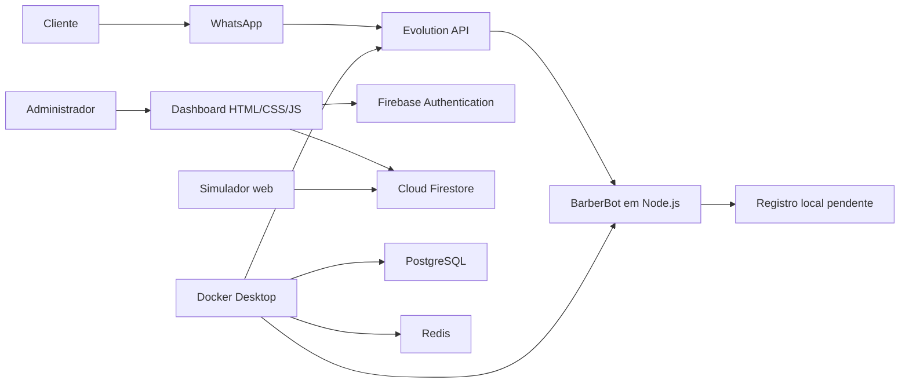

# BarberBot — Barbearia Fio de Ouro

Painel administrativo e assistente de agendamentos desenvolvido para demonstrar como uma barbearia pode organizar clientes, serviços, barbeiros, horários e atendimentos em um único sistema.

O projeto combina um dashboard web conectado ao Firebase, um simulador de conversa e uma integração experimental com o WhatsApp por meio da Evolution API. O objetivo é servir como projeto de demonstração, portfólio e base reutilizável para futuras soluções comerciais.

Para compreender a construção completa, a hierarquia e a ordem manual de implementação, consulte o [Raio X do projeto](RAIO-X-DO-PROJETO.md).

> **Estado do projeto:** demonstração funcional em desenvolvimento. O painel e o simulador utilizam dados reais do Firestore. A conversa pelo WhatsApp já funciona localmente, mas a gravação final dos agendamentos recebidos pelo WhatsApp no Firestore ainda é uma etapa pendente.

---

## Visão geral

O BarberBot foi pensado para resolver tarefas comuns de uma barbearia:

- centralizar os agendamentos;
- evitar clientes e horários fictícios no painel;
- cadastrar clientes, barbeiros e serviços;
- controlar dias e horários de funcionamento;
- mostrar notificações somente quando houver eventos reais;
- permitir que o administrador confirme, inicie ou cancele atendimentos;
- fornecer relatórios operacionais;
- proteger o painel com autenticação de administrador;
- automatizar o primeiro atendimento pelo WhatsApp;
- oferecer uma demonstração segura mesmo quando o WhatsApp não estiver conectado.

O visual original do dashboard foi preservado durante a implementação das funcionalidades.

---

## Funcionalidades implementadas

### Painel administrativo

- login com Firebase Authentication;
- acesso restrito ao administrador;
- saudação automática de acordo com o horário;
- resumo dos agendamentos do dia;
- indicadores de agendados, confirmados, em atendimento e cancelados;
- tabela alimentada com registros reais do Firestore;
- filtro por data e busca por cliente;
- opção **Ver todos**;
- atualização do status dos atendimentos;
- notificações dinâmicas;
- modais sobrepostos ao painel, sem trocar o design principal;
- ações rápidas para novos cadastros.

### Cadastros e gerenciamento

- cadastro e gerenciamento de clientes;
- cadastro e gerenciamento de barbeiros;
- ativação e inativação de barbeiros;
- cadastro e gerenciamento de serviços;
- duração e preço dos serviços;
- criação e gerenciamento de agendamentos;
- prevenção de conflitos de horário;
- configuração dos horários de funcionamento;
- definição da antecedência mínima para agendar;
- configurações gerais da barbearia.

### Relatórios

- filtros por período;
- totais de atendimentos;
- informações por serviço;
- acompanhamento do movimento registrado no sistema.

### Simulador do BarberBot

O arquivo `simulador.html` oferece uma conversa parecida com o WhatsApp sem depender de nenhuma plataforma externa.

O simulador:

- solicita nome e telefone;
- carrega serviços e barbeiros ativos do Firestore;
- consulta os dias de funcionamento;
- calcula horários disponíveis;
- considera a duração do serviço;
- respeita a antecedência mínima configurada;
- impede sobreposição com agendamentos existentes;
- confirma e grava o agendamento na coleção `agendamentos`;
- atualiza o painel automaticamente.

### BarberBot no WhatsApp — demonstração local

A demonstração pelo WhatsApp utiliza Evolution API, conexão por QR Code, Node.js, Docker Desktop, PostgreSQL, Redis e um webhook privado dentro da rede do Docker.

O bot atualmente executa este fluxo:

1. recebe `Oi`;
2. solicita o nome do cliente;
3. apresenta as opções de serviço;
4. pergunta a data;
5. apresenta horários de demonstração;
6. solicita confirmação;
7. registra o resultado localmente em `bot/data/agendamentos-pendentes.jsonl`.

O diretório de dados locais é ignorado pelo Git.

---

## Arquitetura



### Fluxo atual dos dados

| Origem | Destino | Situação |
|---|---|---|
| Painel administrativo | Firestore | Implementado |
| Simulador | Firestore | Implementado |
| Firestore | Painel em tempo real | Implementado |
| WhatsApp | Evolution API | Implementado localmente |
| Evolution API | BarberBot | Implementado localmente |
| BarberBot | Resposta no WhatsApp | Implementado localmente |
| BarberBot | Arquivo local pendente | Implementado |
| BarberBot | Firestore | Pendente |

---

## Tecnologias utilizadas

- HTML5 e CSS3;
- JavaScript moderno com módulos ES;
- Node.js 22;
- Firebase Authentication;
- Cloud Firestore;
- Firebase Functions preparado para integração oficial futura;
- Docker Desktop e Docker Compose;
- Evolution API;
- PostgreSQL e Redis;
- Font Awesome e Google Fonts.

---

## Estrutura do projeto

```text
barbearia-agente/
├── index.html                 # Dashboard administrativo
├── style.css                 # Estilos do dashboard
├── script.js                 # Funcionalidades e integração com Firestore
├── firebase.js               # Inicialização e exportações do Firebase
├── simulador.html            # Interface de demonstração do BarberBot
├── simulador.css             # Estilos do simulador
├── simulador.js              # Fluxo e gravação real no Firestore
├── firebase.json             # Configuração do Firebase CLI
├── .firebaserc               # Projeto Firebase selecionado
├── .gitignore                # Arquivos privados ou gerados localmente
├── midias/                   # Imagens e recursos visuais
├── bot/
│   ├── Dockerfile            # Imagem do bot local
│   ├── package.json          # Configuração do bot
│   ├── server.js             # Conversa e webhook da Evolution API
│   └── data/                 # Agendamentos locais, ignorados pelo Git
├── evolution/
│   ├── docker-compose.yml    # Evolution API, bot, PostgreSQL e Redis
│   ├── .env                  # Configuração local privada, ignorada pelo Git
│   └── .env.example          # Modelo seguro de configuração
└── functions/
    ├── index.js              # Webhook preparado para a API oficial da Meta
    ├── package.json          # Dependências do Firebase Functions
    └── README.md             # Documentação do webhook oficial
```

---

## Coleções do Firestore

### `agendamentos`

Principais campos:

- `client`: nome do cliente;
- `phone`: telefone;
- `service`: serviço escolhido;
- `barber`: barbeiro responsável;
- `date`: data no formato `AAAA-MM-DD`;
- `time`: horário;
- `duration`: duração em minutos;
- `price`: valor do serviço;
- `status`: `scheduled`, `confirmed`, `in-service` ou `cancelled`;
- `source`: origem do agendamento;
- `createdAt`: data de criação.

### Outras coleções e documentos

- `clientes`: dados cadastrados dos clientes;
- `barbeiros`: profissionais e status;
- `servicos`: nome, duração, preço e status;
- `configuracoes/horarios`: dias, abertura, fechamento e intervalo;
- `configuracoes/barbearia`: dados comerciais, mensagem e antecedência mínima.

> As regras atuais foram configuradas para permitir acesso administrativo autenticado. Nunca use regras públicas em produção.

---

## Pré-requisitos

### Painel e simulador

- navegador moderno;
- Live Server ou outro servidor HTTP local;
- projeto Firebase configurado;
- conta administrativa no Firebase Authentication.

### Bot pelo WhatsApp

- Windows com WSL 2;
- Docker Desktop;
- Node.js para verificações locais;
- número secundário recomendado para testes;
- outro número para enviar mensagens ao número conectado.

---

## Executando o painel

1. Abra a pasta no Visual Studio Code.
2. Inicie `index.html` com Live Server.
3. Acesse:

```text
http://127.0.0.1:5500/index.html
```

4. Entre com a conta administrativa cadastrada no Firebase Authentication.

Não abra o HTML com `file://`, pois os módulos JavaScript precisam de um servidor HTTP.

---

## Executando o simulador

Com o Live Server aberto, acesse:

```text
http://127.0.0.1:5500/simulador.html
```

Também é possível usar o botão disponível na área **Configurações** do painel.

O usuário precisa estar autenticado como administrador na mesma origem para que as regras atuais do Firestore permitam a gravação.

---

## Executando a integração local com o WhatsApp

### 1. Iniciar o Docker Desktop

Abra o Docker Desktop e aguarde até o mecanismo ficar ativo.

### 2. Subir os serviços

No PowerShell, entre na pasta `evolution` e execute:

```powershell
docker compose up -d --build
```

O comando inicia:

- `barberbot_evolution_api`;
- `barberbot_evolution_postgres`;
- `barberbot_evolution_redis`;
- `barberbot_local`.

### 3. Verificar os serviços

```powershell
docker compose ps
```

### 4. Acompanhar os logs

```powershell
docker logs -f barberbot_local
```

### 5. Conectar o WhatsApp

A instância `barberbot` deve ser criada na Evolution API e conectada por QR Code. No celular:

1. abra o WhatsApp;
2. acesse **Aparelhos conectados**;
3. selecione **Conectar um aparelho**;
4. leia o QR Code gerado pela Evolution API.

### 6. Testar

Utilize outro número de WhatsApp para enviar:

```text
Oi
```

O bot ignora mensagens enviadas pelo próprio número conectado para impedir ciclos infinitos.

### 7. Parar os serviços

```powershell
docker compose down
```

Os volumes preservam dados entre reinicializações. Não remova os volumes sem necessidade.

---

## Variáveis de ambiente

O arquivo `evolution/.env` contém configurações locais e não deve ser enviado ao GitHub.

Use `evolution/.env.example` como modelo e defina valores próprios para a chave da API, credenciais do PostgreSQL, URL do servidor e origens autorizadas.

Nunca coloque no JavaScript do navegador:

- senhas;
- tokens permanentes;
- chaves administrativas;
- credenciais de serviço;
- segredos de webhook.

---

## Segurança

- o painel exige login administrativo;
- as coleções administrativas são protegidas no Firestore;
- a Evolution API está publicada somente em `127.0.0.1`;
- PostgreSQL e Redis não são expostos à internet;
- o webhook fica na rede privada do Docker;
- arquivos `.env` e dados gerados são ignorados pelo Git;
- mensagens enviadas pelo próprio número são descartadas;
- o servidor limita o tamanho dos payloads.

Antes de publicar:

1. troque todas as chaves e senhas;
2. utilize HTTPS;
3. configure backups;
4. autentique e valide webhooks;
5. revise as regras do Firestore;
6. use um servidor seguro;
7. obtenha consentimento para armazenar dados;
8. adeque o tratamento dos dados à LGPD.

---

## Evolution API e uso do WhatsApp

A Evolution API utiliza conexão baseada no WhatsApp Web e não representa a integração oficial da Meta.

Consequências:

- a sessão pode ser desconectada;
- mudanças no WhatsApp podem interromper a integração;
- o número pode sofrer limitações ou bloqueios;
- não existe garantia de disponibilidade;
- não deve ser usada para disparos em massa;
- recomenda-se um número secundário durante o desenvolvimento.

Para produção, a opção recomendada é a WhatsApp Business Platform oficial, um provedor oficial ou a apresentação clara dos riscos da solução não oficial.

O diretório `functions` mantém a base segura para uma integração oficial futura com a Cloud API da Meta.

---

## Solução de problemas

### Docker mostra “WSL not installed”

Em um PowerShell aberto como administrador:

```powershell
wsl --install
```

Reinicie o Windows depois da instalação.

### O Docker não inicia

- confirme que o WSL 2 está ativo;
- reinicie o Docker Desktop;
- execute `wsl --list --verbose`;
- confirme que a distribuição utiliza a versão 2.

### O bot não responde

```powershell
docker compose ps
docker logs --tail 100 barberbot_local
docker logs --tail 100 barberbot_evolution_api
```

Confirme também que:

- o estado da instância é `open`;
- o webhook está habilitado;
- o evento `MESSAGES_UPSERT` está ativo;
- a mensagem veio de outro número;
- o Docker Desktop está aberto.

### O QR Code não aparece

Se a instância estiver com estado `open`, ela já está conectada e não gera outro QR Code. Desconectar ou remover uma instância apaga a sessão; faça isso somente para conectar outro número.

### O painel não carrega dados

- confirme a autenticação;
- verifique as regras do Firestore;
- confira o console do navegador;
- teste sem extensões que bloqueiam requisições;
- confirme o projeto Firebase.

### O agendamento do WhatsApp não aparece no painel

Essa ligação ainda não foi implementada. Atualmente, o bot registra em:

```text
bot/data/agendamentos-pendentes.jsonl
```

O simulador web já grava diretamente no Firestore e atualiza o painel.

---

## Comandos úteis

Dentro da pasta `evolution`:

```powershell
# Iniciar ou atualizar
docker compose up -d --build

# Ver o estado
docker compose ps

# Acompanhar o bot
docker logs -f barberbot_local

# Acompanhar a Evolution API
docker logs -f barberbot_evolution_api

# Reiniciar apenas o bot
docker compose restart barberbot

# Parar os serviços
docker compose down
```

Verificação de sintaxe:

```powershell
node --check script.js
node --check simulador.js
node --check bot/server.js
```

---

## Limitações atuais

- integração com WhatsApp local e experimental;
- computador e Docker precisam permanecer ligados;
- serviços e horários do WhatsApp ainda são opções de demonstração;
- sessões de conversa ficam em memória;
- confirmações do WhatsApp ainda não são gravadas no Firestore;
- não existe implantação pública 24 horas;
- o webhook oficial da Meta está preparado, mas ainda não responde;
- ainda faltam testes automatizados.

---

## Próximas etapas recomendadas

1. integrar `bot/server.js` ao Firestore com credenciais de servidor seguras;
2. carregar serviços, barbeiros e horários reais no bot;
3. validar conflitos antes da confirmação;
4. salvar o agendamento na coleção `agendamentos`;
5. cadastrar ou atualizar o cliente automaticamente;
6. exibir a nova notificação no painel;
7. persistir o estado das conversas;
8. permitir cancelamento e reagendamento;
9. adicionar lembretes automáticos;
10. criar testes automatizados;
11. preparar implantação 24 horas;
12. migrar clientes que exigirem estabilidade para a API oficial.

---

## Uso como projeto comercial

Cada implantação para cliente deve possuir:

- projeto Firebase próprio;
- administrador próprio;
- identidade visual própria;
- serviços, preços, profissionais e horários próprios;
- número de WhatsApp próprio;
- chaves e senhas exclusivas;
- regras de segurança revisadas;
- política de privacidade e tratamento de dados.

Não reutilize credenciais entre clientes.

---

## Aviso

Este projeto é uma demonstração educacional e de portfólio. Ele não representa afiliação oficial com WhatsApp, Meta, Firebase ou Evolution API.

Antes do uso comercial, faça uma revisão técnica, jurídica e de segurança, especialmente sobre disponibilidade, termos das plataformas, consentimento e LGPD.

---

## Autor e personalização

Projeto desenvolvido como base para o **BarberBot — Barbearia Fio de Ouro**.

O nome, as imagens, as cores, os textos, os serviços e os dados podem ser personalizados para cada implantação sem alterar a arquitetura principal.
